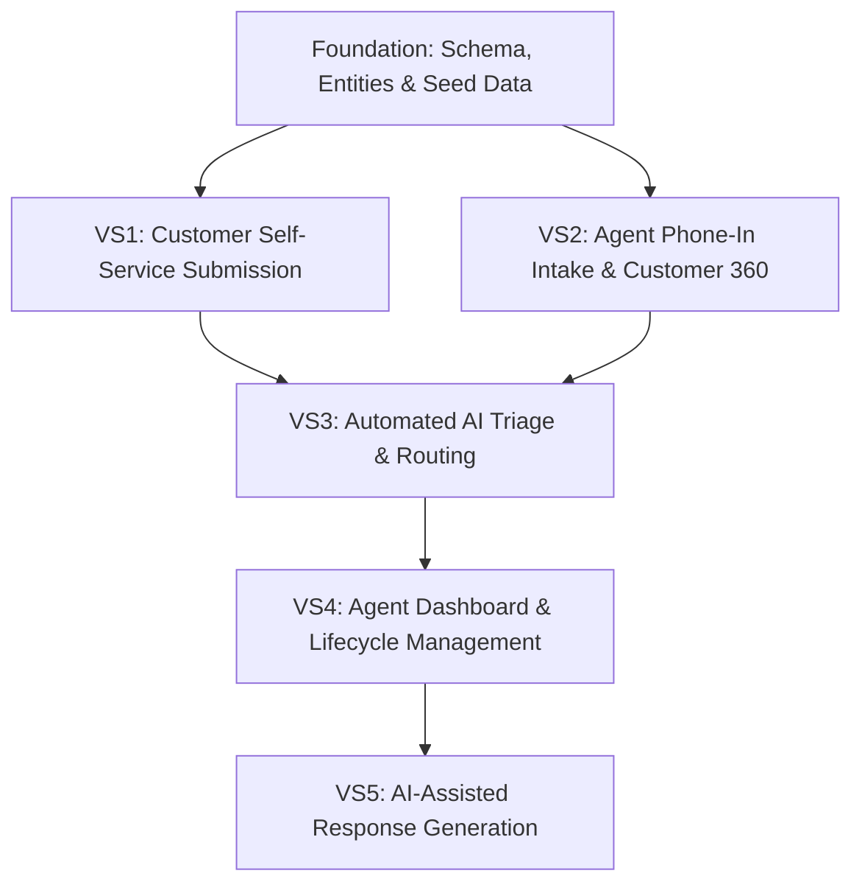

# Master Implementation Plan & Vertical Slice Roadmap

## Executive Overview
The **ISP Support AI** platform is an AI-assisted customer operations system for Internet Service Providers. It streamlines subscriber issue intake, automates incident triage and prioritization through deterministic business rules and structured LLM analysis, and assists support agents with AI-drafted responses under strict human-in-the-loop oversight.

The system is designed as a clean, decoupled modular monolith:
- **Backend**: NestJS 10, TypeScript, TypeORM, PostgreSQL, REST APIs.
- **Frontend**: Next.js 14 (App Router), React 18, Tailwind CSS, Lucide icons.
- **AI Integration**: Direct structured LLM invocations (JSON Schema) with strict application validation, timeouts, and fallbacks. No vector databases, agents, or RAG.

---

# 1. Project Inspection & Consistency Review

### 1.1 Architectural Alignment
- **Domain Modules**: Conforms to [`rules/backend.mdc`](file:///d:/Development/AI-Native%20Development/Internet%20Service%20Provider%20AI%20Support%20Ticketing%20System/rules/backend.mdc) with domain modules: `customers/`, `services/`, `tickets/`, `support-teams/`, `ai/`, and `common/`.
- **Approved ERD**: Authoritative data model confirmed:
  - `Customer` 1:N `Service`
  - `Customer` 1:N `Ticket`
  - `SupportTeam` 1:N `Ticket`
  - `Ticket` 1:1 `AiAnalysis` (dedicated table for auditability and observability)
  - No `ticket_messages` entity (removed for MVP simplicity).
  - No `service_id` foreign key on `Ticket` (tickets tie directly to `Customer`).

### 1.2 Identified Inconsistencies & Corrective Actions
1. **Docker Compose Redis**: The initial scaffold generated a Redis container in `docker-compose.yml`. Per project rules ("Avoid microservices, Kafka, Redis, vector databases..."), Redis is not needed for the MVP. **Action**: Remove Redis and retain pure PostgreSQL 16.
2. **Scaffolded Ticket Entity**: The bootstrap file `backend/src/tickets/entities/ticket.entity.ts` included an inline `aiSummary` column and lacked relational foreign keys. **Action**: Replace with the approved schema during Foundation setup.
3. **OpenAPI / Swagger**: Referenced in rules but not yet initialized in `main.ts`. **Action**: Include Swagger initialization during Foundation setup.

---

# 2. Master Implementation Plan

### 2.1 Major System Capabilities
1. **Subscriber Self-Service**: Portal for customers to log issues, view ticket history, and monitor real-time resolution status.
2. **Agent Phone-In Intake (Customer 360)**: Instant subscriber phone lookup to verify account details, subscription tier, and ONT equipment before filing a ticket.
3. **Automated AI Triage & Deterministic Routing**: Instantaneous issue classification, severity estimation, sentiment detection, and automated routing to the responsible team (e.g., `FIBER_SIGNAL_LOSS` $\rightarrow$ `NETWORK_OPERATIONS`).
4. **Agent Operations Dashboard**: Centralized queue with status, priority, and team filtering, customer context, and lifecycle management.
5. **AI Copilot Response Generation**: Human-in-the-loop response suggestions that agents can review, edit, and send.

### 2.2 Major Backend Capabilities
- Thin REST controllers delegating to domain services.
- Deterministic rules engine executing business-critical routing and prioritization decisions.
- Strict DTO validation via `class-validator` and `class-transformer`.
- TypeORM database migrations ensuring reproducible database schema evolution.
- AI orchestration layer enforcing structured JSON outputs, timeouts (8s), PII sanitization, and fallback heuristics.

### 2.3 Major Frontend Capabilities
- Next.js 14 App Router separating Customer Portal (`/(customer)`) and Support Agent Dashboard (`/(agent)`).
- Typed REST client (`src/lib/api.ts`) abstracting backend communication.
- Responsive Tailwind CSS interface with operational status indicators and diagnostic widgets.

### 2.4 Infrastructure & Dependencies
- **Runtime**: Node.js v20+, TypeScript 5.x.
- **Database**: PostgreSQL 16 (orchestrated via Docker Compose).
- **Core Libraries**: `@nestjs/typeorm`, `typeorm`, `pg`, `@nestjs/config`, `class-validator`, `lucide-react`, `tailwind-merge`.
- **LLM Connectivity**: Official provider SDK or fetch client using structured JSON outputs.

### 2.5 Major Implementation Risks & Mitigations
- **LLM Latency & Timeouts**: Mitigated by strict 8-second client timeouts and non-blocking fallback triage (`AI_REVIEW_REQUIRED`).
- **Prompt Injection & Data Leaks**: Mitigated by PII scrubbing and strict prompt separation from user input.
- **Schema Drift**: Mitigated by relying solely on TypeORM migrations (disabling `synchronize` in production).

---

# 3. Vertical Slice Roadmap

```
Foundation: Database Schema, Domain Skeletons & Core Infrastructure
    │
    ▼
VS1: Customer Self-Service Ticket Submission & Tracking
    │
    ▼
VS2: Support Agent Phone-In Intake & Customer 360 Lookup
    │
    ▼
VS3: Automated AI Ticket Triage & Deterministic Routing
    │
    ▼
VS4: Support Agent Dashboard & Ticket Lifecycle Management
    │
    ▼
VS5: AI-Assisted Agent Response Generation (Human-in-the-Loop)
```

---

### Foundation — Database Schema, Domain Skeletons & Infrastructure

- **Goal**: Establish clean database persistence, approved domain entities, seed data, and API scaffolding.
- **User / Business Outcome**: Developers have a verified, reproducible backend and frontend foundation with a seeded database.
- **Scope**: Clean up `docker-compose.yml` (PostgreSQL only), implement TypeORM entities (`Customer`, `Service`, `SupportTeam`, `Ticket`, `AiAnalysis`), create initial migration, configure seed script (teams and sample customers), and setup Swagger documentation.
- **Backend**: TypeORM setup, configuration, entity definitions, migration runner, base module skeletons (`customers`, `services`, `tickets`, `support-teams`, `ai`, `common`).
- **Frontend**: Aligned shared TypeScript types and base API client skeleton.
- **Database**: Full relational schema according to the approved ERD.
- **AI**: None.
- **Dependencies**: None.
- **Acceptance Criteria**:
  1. `docker compose up -d` boots PostgreSQL with persistent volume.
  2. TypeORM migrations run cleanly and generate all tables with foreign keys and unique constraints.
  3. Seed script creates default support teams (`NETWORK_OPERATIONS`, `TECHNICAL_SUPPORT`, `BILLING`, `INSTALLATION`) and 3 test customers with services.
  4. Backend builds and Swagger UI is accessible at `http://localhost:3000/api`.
- **Complexity**: Medium.
- **Out of Scope**: UI components, AI prompts, business logic.

---

### Slice 1 — Customer Self-Service Ticket Submission & Tracking

- **Goal**: Enable subscribers to submit a support ticket online and monitor its progress in real-time.
- **User / Business Outcome**: Customers can report outages and connectivity problems without waiting on hold on the telephone.
- **Scope**: Customer ticket creation form, backend ticket creation endpoint for customers, ticket persistence with auto-generated ticket numbers, and customer ticket list/detail view.
- **Backend**:
  - `POST /tickets` (extracts customer identity, validates payload, stores ticket with default status `OPEN` and priority `MEDIUM`).
  - `GET /tickets` (filtered by authenticated/specified `customerId`).
  - `GET /tickets/:id` (returns ticket details).
- **Frontend**:
  - Customer ticket submission page (`/(customer)/tickets/new`) with title and description inputs.
  - Customer ticket list view (`/(customer)/tickets`) showing status badges and timestamps.
- **Database**: `tickets` table insert and query operations linked to `customers`.
- **AI**: None (baseline end-to-end data flow).
- **Dependencies**: Foundation.
- **Acceptance Criteria**:
  1. Submitting the form creates a ticket in PostgreSQL with a formatted `ticketNumber` (e.g. `TIC-1001`).
  2. The ticket is immediately visible in the customer's ticket tracking list.
  3. Form displays validation errors if subject or description is empty.
- **Complexity**: Low.
- **Out of Scope**: Agent workflows, phone lookups, AI triage.

---

### Slice 2 — Support Agent Phone-In Intake & Customer 360 Lookup

- **Goal**: Empower call center agents to quickly look up callers by phone number, review their subscription/equipment status, and file a ticket on their behalf.
- **User / Business Outcome**: Faster first-call resolution and elimination of orphan tickets by ensuring every phone complaint is immediately tied to verified customer records.
- **Scope**: Customer phone search endpoint, Customer 360 profile card, and agent ticket submission modal with phone resolution.
- **Backend**:
  - `GET /customers/by-phone/:phone` (retrieves customer details and associated services).
  - `POST /tickets` enhancement: If submitted by an agent, resolves `customerPhone` to a valid `customerId` or throws `NotFoundException`.
- **Frontend**:
  - Agent intake screen (`/(agent)/intake`) with phone search bar.
  - Customer 360 info panel showing customer name, account number, package tier, and ONT status.
  - One-click ticket creation modal linked to the selected customer.
- **Database**: Queries joining `customers` and `services`.
- **AI**: None.
- **Dependencies**: Foundation, Slice 1.
- **Acceptance Criteria**:
  1. Searching an existing customer phone (e.g. `+1-555-0199`) returns their profile and active broadband service within 200ms.
  2. Submitting a ticket with that phone number correctly persists the ticket tied to the retrieved customer.
  3. Searching a non-existent phone number displays a clear "Subscriber not found" warning.
- **Complexity**: Low.
- **Out of Scope**: AI triage, ticket reassignment, billing changes.

---

### Slice 3 — Automated AI Ticket Triage & Deterministic Routing

- **Goal**: Automatically classify incoming tickets using structured LLM analysis and route them to the appropriate support team using deterministic business rules.
- **User / Business Outcome**: Eliminates manual triage delays; critical technical incidents (e.g. fiber breaks) are routed to Network Operations within seconds of submission.
- **Scope**: AI structured prompt execution, JSON schema validation, deterministic routing rules engine, storage of 1:1 `AiAnalysis`, and triage UI badges.
- **Backend**:
  - `AiService`: Formats prompt, calls LLM API with structured output schema (`category`, `issue_type`, `severity`, `sentiment`, `intent`, `confidence`, `requires_technician`, `suggested_team`).
  - Schema validator: Verifies model response conforms to required types and enums; applies fallback (`AI_REVIEW_REQUIRED`) if invalid.
  - Deterministic Routing Service: Applies rule-based assignment (e.g. `FIBER_SIGNAL_LOSS` $\rightarrow$ `NETWORK_OPERATIONS`, forced `CRITICAL` priority).
  - Hook ticket creation (`POST /tickets`) to trigger triage and persist `ai_analyses` record.
  - `POST /tickets/:id/analyze` endpoint for on-demand re-triage.
- **Frontend**:
  - Display AI triage results on ticket cards (Category tag, Priority badge, Sentiment indicator).
  - Triage drawer displaying model confidence and technician requirement alert.
- **Database**: Insert/update operations on `ai_analyses` table (1:1 with `tickets`).
- **AI**:
  - Prompt template (`prompts/triage-v1.ts`).
  - Structured output schema enforcement.
  - Temperature set to 0.1 for high reproducibility.
  - Token and latency tracking stored in `ai_analyses`.
- **Dependencies**: Slice 1, Slice 2.
- **Acceptance Criteria**:
  1. Creating a ticket describing a fiber cut automatically populates `ai_analyses` with `category: "CONNECTIVITY"`, `issue_type: "FIBER_SIGNAL_LOSS"`.
  2. Deterministic rule automatically assigns `support_team_id` to Network Operations.
  3. If LLM call times out or fails, ticket creation still succeeds with `status: OPEN`, priority `MEDIUM`, and `validation_status: "AI_REVIEW_REQUIRED"`.
- **Complexity**: High.
- **Out of Scope**: Response generation, customer notifications, telemetry hardware APIs.

---

### Slice 4 — Support Agent Dashboard & Ticket Lifecycle Management

- **Goal**: Provide support agents and team leads with a centralized operational workspace to filter, manage, reassign, and resolve support tickets.
- **User / Business Outcome**: Teams can prioritize backlogs, manage ticket states, and override incorrect AI classifications.
- **Scope**: Agent queue dashboard, multi-facet filtering, ticket detail view with customer and AI diagnostics, status transition actions, and human override tracking.
- **Backend**:
  - `GET /tickets` query parameters (`status`, `priority`, `teamId`, `search`).
  - `PATCH /tickets/:id` (updates status, priority, assigned agent, or support team).
  - `GET /support-teams` (lists available teams for routing dropdowns).
  - Human override tracking: If an agent changes the AI-assigned team or category, updates `ai_analyses.validation_status` to `"OVERRIDDEN"`.
- **Frontend**:
  - Agent Dashboard table with tabbed status filters (`All`, `Open`, `In Progress`, `Resolved`, `Closed`).
  - Priority indicators (`Critical`, `High`, `Medium`, `Low`) with color-coded styling.
  - Ticket detail drawer / view displaying ticket history, Customer 360 summary, and AI analysis card.
  - Lifecycle action controls ("Start Work", "Reassign Team", "Resolve Ticket").
- **Database**: Updates to `tickets` and `ai_analyses`.
- **AI**: Observability update logging agent override status.
- **Dependencies**: Slice 3.
- **Acceptance Criteria**:
  1. Agent can filter the queue to see only `CRITICAL` tickets assigned to `NETWORK_OPERATIONS`.
  2. Agent can change a ticket from `OPEN` to `IN_PROGRESS` and assign it to themselves.
  3. If agent overrides the assigned team, the database records the override in `ai_analyses.validation_status`.
- **Complexity**: Medium.
- **Out of Scope**: Customer live chat, automated email dispatch.

---

### Slice 5 — AI-Assisted Agent Response Generation (Human-in-the-Loop)

- **Goal**: Enable support agents to generate a tailored, professional response draft with one click, review/edit the draft, and mark the ticket with the approved resolution.
- **User / Business Outcome**: Reduces agent drafting time from several minutes to under 30 seconds while guaranteeing that no AI response is sent to subscribers without human approval.
- **Scope**: Backend response draft generation endpoint, structured prompt with customer and issue context, frontend draft editor with review/approve actions.
- **Backend**:
  - `POST /tickets/:id/suggest-response`: Gathers ticket description, customer name, package details, and triage diagnosis; prompts LLM to generate an empathetic and technically accurate draft.
  - Records token usage, model, and latency.
- **Frontend**:
  - "Generate AI Response" action button in the ticket detail view.
  - Response review panel showing the generated suggestion inside an editable textarea.
  - "Approve & Apply" action button that saves the final approved text.
- **Database**: Updates to `ai_analyses` or audit metadata.
- **AI**:
  - Response generation prompt template (`prompts/response-v1.ts`).
  - Temperature set to 0.3 for natural tone while adhering strictly to provided facts.
  - Strict human-in-the-loop guardrail: response is an untrusted suggestion until saved by an agent.
- **Dependencies**: Slice 4.
- **Acceptance Criteria**:
  1. Clicking "Generate AI Response" produces an editable draft tailored to the ticket's specific issue within 4 seconds.
  2. Agent can modify the text before approving.
  3. No response is ever stored or dispatched without explicit agent approval.
- **Complexity**: Medium.
- **Out of Scope**: Autonomous auto-reply without human review, customer messaging threads.

---

# 4. Correct Sequence & Dependency Analysis



### Rationale
1. **Foundation First**: Establishes data integrity, reproducible Docker PostgreSQL services, TypeORM entities, and eliminates architectural uncertainty early.
2. **VS1 & VS2 Establish Dual Ingestion**: Validates both entry pathways (Customer self-service vs Agent phone-in lookup) using simple, deterministic CRUD before introducing probabilistic AI.
3. **VS3 Introduces AI Triage**: Hooks directly into the verified ticket creation pipeline, adding value immediately by classifying and routing incoming tickets.
4. **VS4 Completes the Operational Loop**: Gives NOC agents the tools to filter, inspect, work on, and resolve the triaged tickets.
5. **VS5 Delivers Human-in-the-Loop Copilot**: Builds directly on top of the agent ticket view, empowering agents to draft responses rapidly with full context.

---

# 5. MVP vs. Post-MVP Boundaries

### MVP Vertical Slices (Core Product Value)
- **Foundation**: Database, migrations, and module skeletons.
- **VS1**: Customer Self-Service Ticket Submission & Tracking.
- **VS2**: Support Agent Phone-In Intake & Customer 360 Lookup.
- **VS3**: Automated AI Ticket Triage & Deterministic Routing.
- **VS4**: Support Agent Dashboard & Ticket Lifecycle Management.
- **VS5**: AI-Assisted Agent Response Generation (Human-in-the-Loop).

### Post-MVP Vertical Slices (Future Enhancements)
- **VS6 (Post-MVP) — On-Demand Diagnostic Re-Analysis & Evaluation Workbench**: Admins test prompt variations against a golden dataset of historic ISP tickets.
- **VS7 (Post-MVP) — Live ISP Network Telemetry Fusion**: Real-time SNMP/RADIUS optical power loss queries integrated directly into triage prompts.
- **VS8 (Post-MVP) — Automated Multi-Channel Notifications**: Real-time SMS and email dispatch for ticket progress and CSAT surveys.
- **VS9 (Post-MVP) — Advanced Role-Based Access Control (RBAC)**: Fine-grained permissions per support tier (Tier 1 vs Tier 2 vs NOC Admin).

---

# 6. Cross-Cutting Concerns Strategy

| Concern | Strategy & Scope | Introduction Timing |
| :--- | :--- | :--- |
| **Database Migrations** | TypeORM CLI migrations strictly enforced; `synchronize: false`. | **Required Early** (Foundation) |
| **Error Handling & Validation** | NestJS global `ValidationPipe` with `class-validator`, sanitized HTTP exceptions. | **Required Early** (Foundation) |
| **Logging & Observability** | NestJS built-in `Logger`, tracking request duration, errors, and AI tokens/latency. | **Introduced Incrementally** (VS3) |
| **AI Fallbacks & Timeouts** | 8s request timeout; safe fallback to `AI_REVIEW_REQUIRED` on failure. | **Introduced Incrementally** (VS3) |
| **Authentication & RBAC** | Lightweight simulated header/context auth (`x-user-role`, `x-customer-id`) for MVP; full JWT/OAuth2 post-MVP. | **Introduced Incrementally** (VS1/VS2) |
| **Testing Strategy** | Unit tests for deterministic routing and DTO validation; mocked LLM responses for CI. | **Introduced Incrementally** (VS1-VS5) |
| **Rate Limiting & Security** | Basic throttling on ticket creation; PII sanitization before sending text to LLMs. | **Introduced Incrementally** (VS3) |
| **Deployment / CI/CD** | Multi-stage Dockerfiles for frontend and backend containers. | **Post-MVP** |

---

# 7. Architectural Decision Points for Review

Before implementing specific slices, the following decisions should be reviewed:
1. **LLM Provider Selection**: Confirm whether to use **Google Gemini API** (via `@google/genai` or `@google/generative-ai`) or **OpenAI API** as the primary LLM provider for structured triage outputs.
2. **Authentication Mocking Strategy**: Confirm that for the MVP, user roles (`customer` vs `agent`) can be supplied via request headers (`x-user-role`, `x-customer-id`) to avoid premature authentication infrastructure before the core domain is functional.
3. **Deterministic Routing Ruleset**: Confirm the initial mapping table of categories/issue types to support teams (e.g. `FIBER_SIGNAL_LOSS` $\rightarrow$ `NETWORK_OPERATIONS`, `BILLING_DISPUTE` $\rightarrow$ `BILLING`).

---

# 8. Final Roadmap Summary

Foundation — Database Schema, Domain Skeletons & Core Infrastructure
↓
VS1 — Customer Self-Service Ticket Submission & Tracking
↓
VS2 — Support Agent Phone-In Intake & Customer 360 Lookup
↓
VS3 — Automated AI Ticket Triage & Deterministic Routing
↓
VS4 — Support Agent Dashboard & Ticket Lifecycle Management
↓
VS5 — AI-Assisted Agent Response Generation (Human-in-the-Loop)

---

### Current Recommended Next Step

The immediate next step is **Foundation (Database Schema, Domain Skeletons & Core Infrastructure)**. 
Establishing the clean PostgreSQL container, approved TypeORM entities, initial migration, and module skeletons is necessary to provide an unambiguous, verifiable data contract before implementing user-facing features. This completely eliminates schema ambiguity and allows subsequent vertical slices to be built and verified end-to-end without refactoring.
